# Frontend Mentor - Weather App Main

This is a solution to the [weather-app-main on Frontend Mentor](https://www.frontendmentor.io/challenges/weather-app-K1FhddVm49). Frontend Mentor challenges help you improve your coding skills by building realistic projects.

## Table of contents

- [Overview](#overview)
  - [Screenshot](#screenshot)
  - [Links](#links)
- [My process](#my-process)
  - [Built with](#built-with)
  - [What I learned](#what-i-learned)
  - [Continued development](#continued-development)
- [Author](#author)

## Overview

### Screenshot

Screenshots of the final project.

- Designs:

Desktop design imperial:

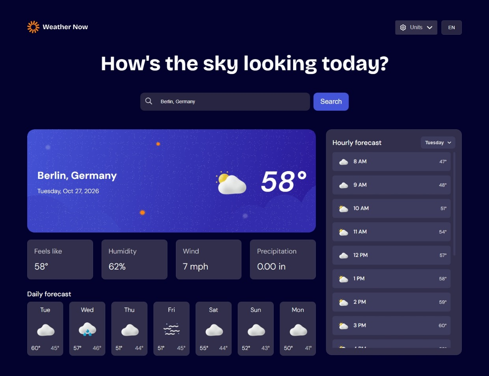

Desktop design metric:

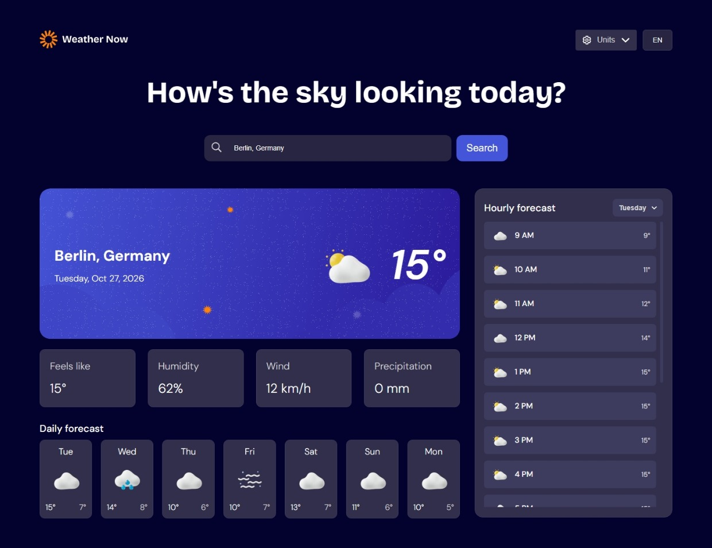

Mobile design imperial:

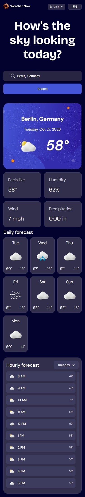

Mobile design metric:

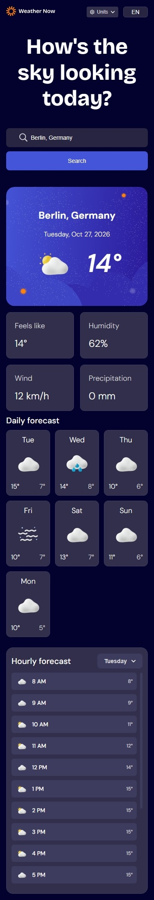

- Languages:

English:

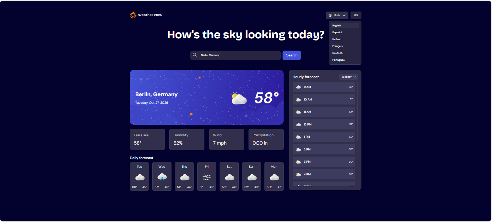

Espanish:


Italian:


French:


Germany:


Portuguese:


- States:

API error:

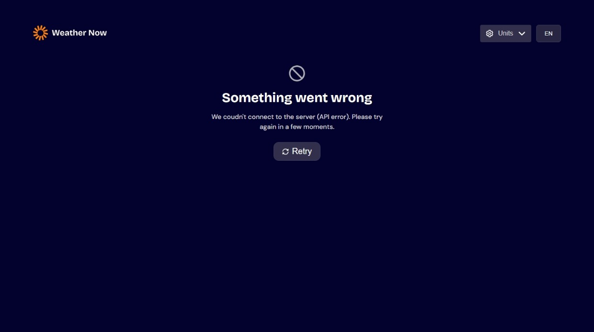

Empty:

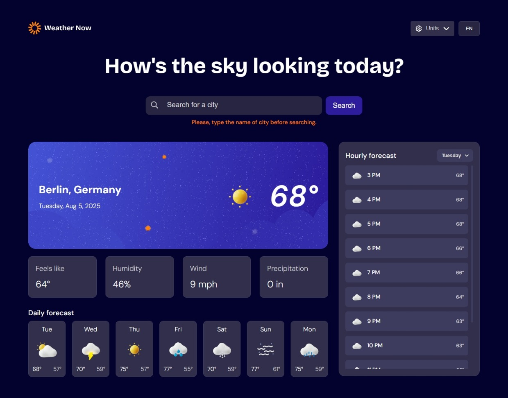

Focus:

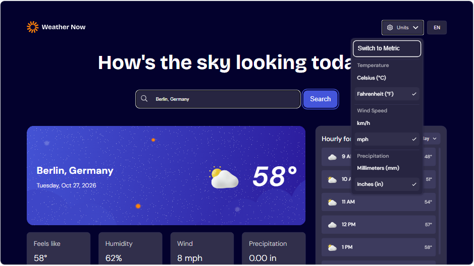

Hover:

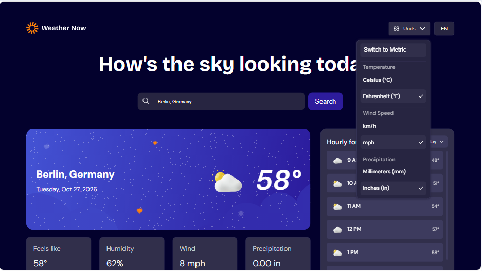

No results:

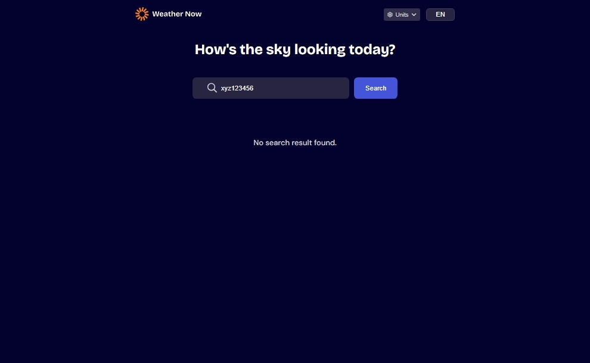

Search in progress/Loading:

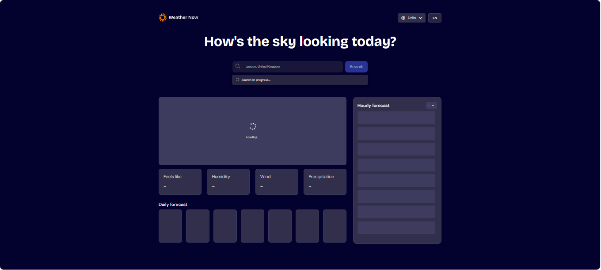


### Links

- Solution URL: [My Solution](https://github.com/gillaercio/weather-app-main)
- Live Site URL: [My Solution](https://gillaercio.github.io/weather-app-main/)

## My process

### Built with

- Semantic HTML5 markup
- CSS custom properties
- Flexbox
- Mobile-first workflow
- JavaScript

### What I learned

I used this project to practice:
- "**BEM methodology with HTML**"
- "**ARIA attributes with HTML**"
- "**CSS Reset**"
- "**CSS Custom Properties (Variables)**"
- "**DOM Manipulation**"
- "**JavaScript Folder Modularization**"

- BEM (Block Element Modifier)

```html
<!-- ... -->
<div class="header__controls">
  <div class="units">
    <button type="button" class="units__button" aria-expanded="false" aria-controls="units-menu" aria-label="Units option menu">
      
      <span class="units__span">Units</span>
      
    </button>
<!-- ... -->
```

- ARIA attributes

```html
<!-- ... -->
<input type="text" id="city" class="form__input" name="city" placeholder="Search for a place..." aria-describedby="city-error" aria-autocomplete="list" aria-controls="city-dropdown" aria-expanded="false" role="combobox">
<!-- ... -->
```

- Reset CSS

```css
*,
:before,
:after {
  margin: 0;
  padding: 0;
  box-sizing: border-box;
}

html {
  font-size: 62.5%;
}
/* ... */
```

- CSS Variables

```css
/* ... */
:root {
  --neutral-900: hsl(243, 96%, 9%);
  --neutral-800: hsl(243, 27%, 20%);
  --neutral-700: hsl(243, 23%, 24%);
  --neutral-600: hsl(243, 23%, 30%);
  --neutral-300: hsl(240, 6%, 70%);
  --neutral-200: hsl(250, 6%, 84%);
  --neutral-0: hsl(0, 0%, 100%);

  --orange-500: hsl(28, 100%, 52%);

  --blue-700: hsl(248, 70%, 36%);
  --blue-500: hsl(233, 67%, 56%);

  --dm-sans: "DM Sans", sans-serif;
  --bricolage-grotesque: "Bricolage Grotesque", sans-serif;

  --txt-xs: 1.2rem;
  --txt-sm: 1.4rem;
  --txt-md: 1.6rem;
  --txt-lg: 1.8rem;
  --txt-xl: 2rem;
  --txt-2xl: 2.2rem;
  --txt-3xl: 2.4rem;

  --fw-light: 300;
  --fw-medium: 500;
  --fw-bold: 700;

  --line-height-sm: 1.2;
  --line-height-md: 1.5;
}
/* ... */
```

- DOM Manipulation

```js
//...
function syncLanguageUI() {
  const languageButton = document.querySelector(".language__button");
  const unitsButtonSpan = document.querySelector(".units__span");
  const unitsToggle = document.querySelector(".units__toggle");
  const headerTitle = document.querySelector(".header__title");
  const searchInput = document.querySelector("#city");
  const submitButton = document.querySelector(".button[type='submit']");
  const searchProgressText = document.querySelector(".search-progress__text");
  const dailyForecastTitle = document.querySelector(".daily-forecast__title");
  const hourlyForecastTitle = document.querySelector(".hourly-forecast__title");

  if (languageButton) {
    languageButton.textContent = appState.language.toUpperCase();
  }

  if (unitsButtonSpan) {
    unitsButtonSpan.textContent = getTranslation("unitsLabel");
  }

  if (unitsToggle) {
    unitsToggle.textContent = appState.isImperial ? getTranslation("switchToMetric") : getTranslation("switchToImperial");
  }

  if (headerTitle) {
    headerTitle.textContent = getTranslation("headerTitle");
  }

  if (searchInput) {
    searchInput.placeholder = getTranslation("searchPlaceholder");
  }

  if (submitButton) {
    submitButton.textContent = getTranslation("searchButton");
  }

  if (searchProgressText) {
    searchProgressText.textContent = getTranslation("loading");
  }

  if (dailyForecastTitle) {
    dailyForecastTitle.textContent = getTranslation("dailyForecast");
  }

  if (hourlyForecastTitle) {
    hourlyForecastTitle.textContent = getTranslation("hourlyForecast");
  }

  syncRetryButtonLanguage();
}
//...
```

- Folder Modularization

To use modularization in .js files, we specify the type="module" in the script tag within the HTML file.
```html
<script type="module" src="assets/js/main.js"></script>
```

config.js
```js
//...
export const config = {
  geocodingBaseUrl: "https://geocoding-api.open-meteo.com/v1/search",
  weatherBaseUrl: "https://api.open-meteo.com/v1/forecast",
  iconsPath: "assets/images/",
  defaultLanguage: "en",
  supportedLanguages: ["en", "es", "it", "fr", "de", "pt"],
  localeMap: {
    en: "en-US",
    es: "es-ES",
    it: "it-IT",
    fr: "fr-FR",
    de: "de-DE",
    pt: "pt-PT"
  },
  translations: {
    en: {
      appName: "Weather App",
      headerTitle: "How's the sky looking today?",
      searchButton: "Search",
      searchPlaceholder: "Search for a city",
      emptyCity: "Please, type the name of city before searching.",
      apiErrorTitle: "Something went wrong",
      apiErrorDescription: "We coudn't connect to the server (API error). Please try again in a few moments.",
      retryButton: "Retry",
      noResults: "No search result found.",
      noResultsDescription: "Try another city name.",
      apiError: "Unable to load weather data.",
      loading: "Search in progress...",
      unitsLabel: "Units",
      languageLabel: "Language",
      switchToMetric: "Switch to Metric",
      switchToImperial: "Switch to Imperial",
      dailyForecast: "Daily forecast",
      hourlyForecast: "Hourly forecast",
      feelslike: "Feels like",
      humidity: "Humidity",
      wind: "Wind",
      precipitation: "Precipitation"
    },
//...
```

render.js
```js
import { config } from "./config.js";
import { appState, getTranslation } from "./state.js";
import {
  formatTemp,
  formatWind,
  formatPrecipitation,
  getWeatherIcon
} from "./formatters.js";

export function syncUnitControls() {
  document.querySelectorAll('input[name="temperature"]').forEach((radio) => {
    radio.checked = radio.value === appState.currentUnits.temperature;
  });

  document.querySelectorAll('input[name="wind"]').forEach((radio) => {
    radio.checked = radio.value === appState.currentUnits.wind;
  });

  document.querySelectorAll('input[name="precipitation"]').forEach((radio) => {
    radio.checked = radio.value === appState.currentUnits.precipitation;
  });
}
//...
```

### Continued development

I would to continue improving my **HTML**, **CSS** and **JavaScript** skills by building more responsive layouts and writing cleaner, more modular code.

## Author

- Frontend Mentor - [@gillaercio](https://www.frontendmentor.io/profile/gillaercio)
- Github - [My Github](https://github.com/gillaercio)
- LinkedIn - [My LinkedIn](https://www.linkedin.com/in/gildman-la%C3%A9rcio/)